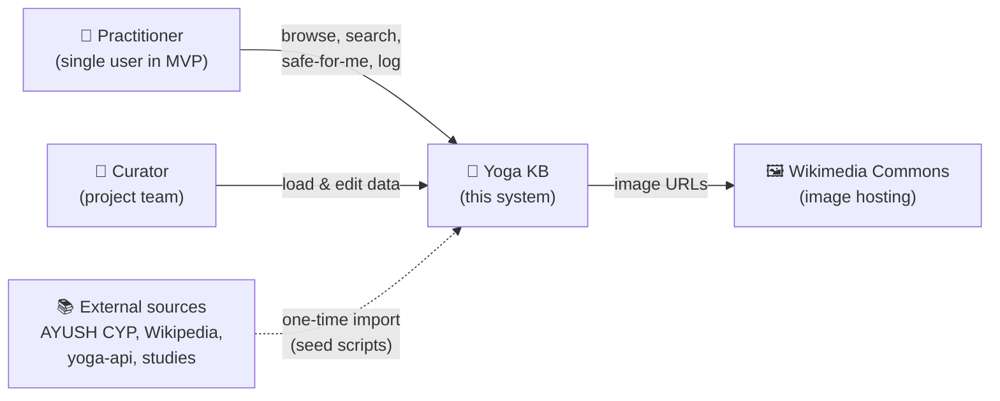
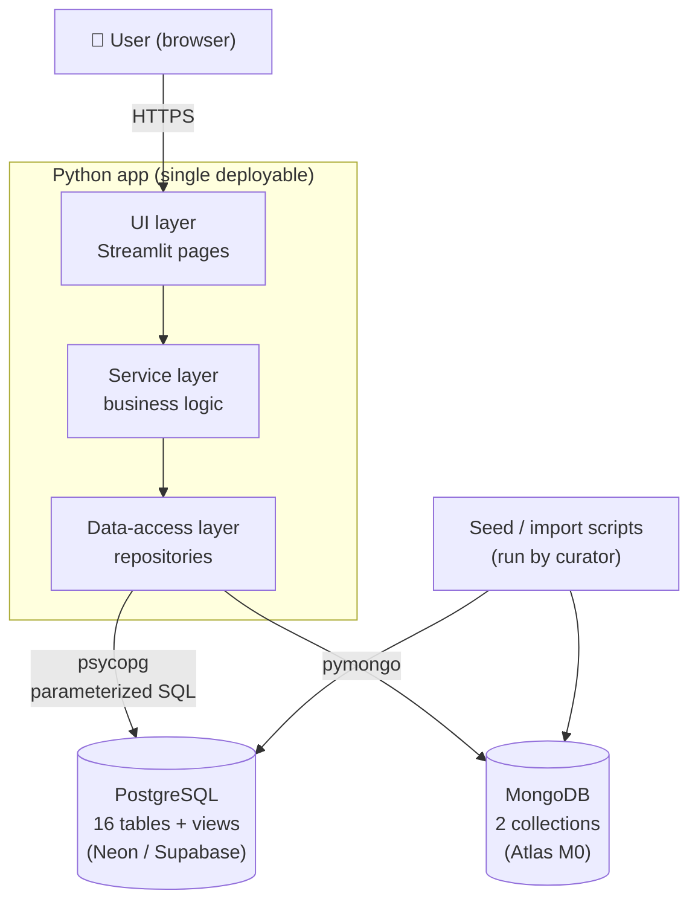
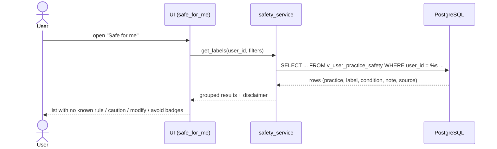
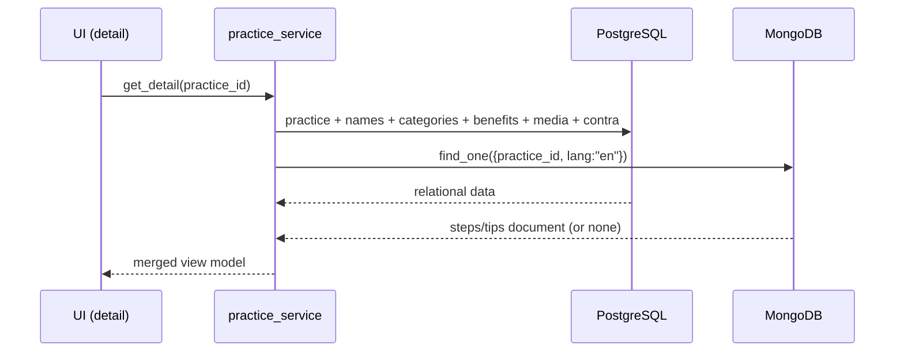
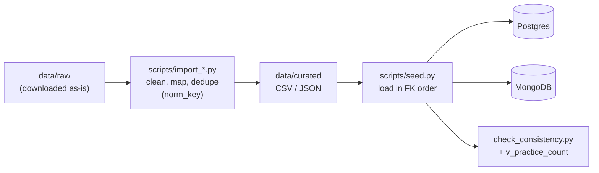
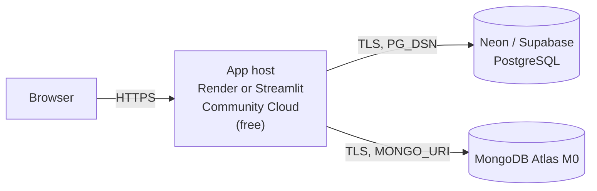

# System Architecture: Yoga Knowledge Base

| | |
|---|---|
| **Version** | 1.0 (MVP) |
| **Last updated** | 2026-11-09 |
| **Method** | Sections follow the **arc42** template. Diagrams follow the **C4 model** (Context → Container → Component). Decisions are recorded as **ADRs** (Architecture Decision Records). These are the standard methods used to document production systems. |
| **Related** | [PRD.md](PRD.md) · [WORKFLOW.md](WORKFLOW.md) · [RESEARCH.md](RESEARCH.md) |

> **How to read this:** sections 1–4 explain *why*. Sections 5–7 explain *what the system is made of*. Sections 8–11 explain *how it behaves and stays safe*. Section 12 lists every big decision and the reason behind it.
> Diagrams are in Mermaid, which GitHub renders automatically.

---

## 1. Introduction and goals
A safety-aware yoga knowledge base. It stores about 500 practices and their health contraindications, each citing a source, and filters them against a user's conditions. The full requirements are in [PRD.md](PRD.md).

### Top quality goals (ranked)
| # | Quality | What it means here |
|---|---|---|
| 1 | **Correctness / integrity** | Safety data must never be silently wrong or unsourced. The database enforces the rules itself. |
| 2 | **Clarity** | The schema and code must be easy to explain in a viva (3NF, clear names). |
| 3 | **Extensibility** | Phase 2 features add tables or collections. They never force a redesign. |
| 4 | **Simplicity** | Free tier, pure Python, one deployable app. |

## 2. Constraints
| Type | Constraint |
|---|---|
| Course | Must use SQL + NoSQL together, 3NF, embedded/dynamic SQL, a security section, recent trends and a societal concern. |
| Tech | PostgreSQL (relational), MongoDB (NoSQL), Python (app + UI). |
| Cost | Free tiers only. |
| Team | Two students, new to DBMS. |
| Legal | Only CC0, CC BY and CC BY-SA images. No copied text from copyrighted books or apps. |

## 3. Context and scope (C4 level 1: System Context)

**In scope:** practice data, safety rules, the user's conditions, favourites, practice log, admin CRUD.
**Out of scope:** medical diagnosis, payments, social features, computer vision.

## 4. Solution strategy
| Problem | Strategy |
|---|---|
| Structured, rule-heavy safety data | **Relational model in PostgreSQL**, normalized to 3NF, with constraints doing the enforcing. |
| Text content that varies by language and length, plus logs | **Document model in MongoDB** (polyglot persistence: each kind of data goes in the store that suits it). |
| Linking the two stores | The **application layer** joins them on `practice_id`. Postgres is the *single source of truth* for which practices exist. |
| "Safe for me" logic | Done **in SQL views**, so the rule lives in one place and is testable with plain SQL. |
| Simple build and deploy | A **modular monolith**: one Python app with clear internal layers. No microservices; they would add cost with no benefit at this size. |
| Reaching about 500 entries honestly | Model **variations as child rows** (a self-referencing foreign key), plus non-asana practice types. |

## 5. Building blocks

### 5.1 C4 level 2: Containers


| Container | Technology | Responsibility |
|---|---|---|
| UI layer | Streamlit (default; Flask + Jinja is the fallback) | Pages, forms, display. **No SQL here.** |
| Service layer | Plain Python modules | Business rules: merging SQL and Mongo results, input validation, the disclaimer. |
| Data-access layer | `psycopg` (v3) for Postgres, `pymongo` for Mongo | All queries. Raw parameterized SQL, **no ORM**. Writing the SQL by hand is the point of a DBMS course. |
| PostgreSQL | PostgreSQL 16+ | Structured data, constraints, safety views. |
| MongoDB | MongoDB 7+ | Instruction content, practice logs. |
| Seed scripts | Python | Turn raw datasets into clean rows and documents, with source and licence tracking. |

### 5.2 C4 level 3: Components (inside the app)
| Module | Responsibility | Talks to |
|---|---|---|
| `app/pages/browse.py` | List, search, filter | `services/practice_service` |
| `app/pages/detail.py` | Full practice page | `practice_service`, `content_service` |
| `app/pages/my_health.py` | Manage my conditions | `safety_service` |
| `app/pages/safe_for_me.py` | Labelled practice list | `safety_service` |
| `app/pages/favourites.py` | Favourites | `user_service` |
| `app/pages/log.py` | Practice log + stats | `log_service` |
| `app/pages/admin.py` | Curator CRUD | all services |
| `services/practice_service.py` | Search, filter, detail assembly | `repos/pg_practice`, `repos/mongo_content` |
| `services/safety_service.py` | Conditions + effective-contraindication results | `repos/pg_safety` |
| `services/user_service.py` | Single user + favourites | `repos/pg_user` |
| `services/log_service.py` | Session CRUD + aggregation stats | `repos/mongo_log`, `repos/pg_practice` (name lookup) |
| `services/content_service.py` | Steps and tips per language | `repos/mongo_content` |
| `repos/*` | One file per table group or collection. Pure query functions. | databases |
| `core/db.py` | Connection pools, reads `.env` | — |
| `core/validate.py` | Input validation + the Mongo operator-injection guard | — |

*These names are the target layout. The build agent may adjust them and must log any change (see AGENTS.md).*

### 5.3 Repository layout
```
yoga-kb/
├─ README.md               # short overview for teammates
├─ AGENTS.md               # build-agent instruction manual + status + change log
├─ docs/
│  ├─ PRD.md
│  ├─ ARCHITECTURE.md      # this file
│  ├─ WORKFLOW.md          # step 0 → end
│  ├─ RESEARCH.md          # sources and dataset research
│  ├─ er/                  # ER diagram (step 2)
│  └─ normalization.md     # 3NF walkthrough (step 3)
├─ db/
│  ├─ postgres/            # 01_types.sql, 02_tables.sql, 03_indexes.sql, 04_views.sql, 05_roles.sql
│  └─ mongo/               # collection validators
├─ data/
│  ├─ raw/                 # downloaded source files (never edited by hand)
│  └─ curated/             # cleaned CSV/JSON ready to load
├─ scripts/                # import_*.py, seed.py, check_consistency.py
├─ app/                    # UI pages + entry point
├─ services/
├─ repos/
├─ core/
├─ tests/
├─ .env.example            # variable names only, no secrets
├─ requirements.txt
└─ .gitignore
```

## 6. Data architecture

### 6.1 Which data goes where (polyglot persistence)
| Data | Store | Reason |
|---|---|---|
| Practices, names, aliases, categories, body parts, benefits | Postgres | Fixed shape, heavily cross-linked, needs joins and constraints |
| Conditions, contraindications, sources | Postgres | Safety-critical: needs FKs, NOT NULL, CHECK, views |
| Media metadata | Postgres | Licence columns must be NOT NULL |
| User, user conditions, favourites | Postgres | Relational, needs uniqueness, joins to the safety views |
| Instruction steps, tips, mistakes, breathing cue | **MongoDB** | Read as one block, step count varies, one document per language. Adding Kannada later means **new documents, no schema change.** |
| Practice sessions (log) | **MongoDB** | Append-heavy, nested items, the aggregation pipeline handles stats |

**"Why not just Postgres JSONB?"** It would work. We chose MongoDB deliberately to show the polyglot pattern the course asks for, and because the content and logs are document-native. The trade-off we accept is keeping two stores in sync (see section 8.4).

### 6.2 Relational model (PostgreSQL, 16 tables)
Naming: `snake_case`, singular table names, surrogate `id` keys, `<table>_id` foreign keys.

**Core**
| Table | Columns | Keys and constraints |
|---|---|---|
| `practice` | id, slug, name_en, name_sa, name_kn, type, parent_id, difficulty, description, created_at, updated_at | PK id · UQ slug · FK parent_id → practice(id) · CHECK difficulty 1–3 · CHECK parent_id ≠ id · type is the ENUM `practice_type` (asana / pranayama / mudra / bandha / kriya / meditation; a variation is any row with a parent_id) |
| `alias` | id, practice_id, alias_text, norm_key | PK id · FK practice_id · UQ (practice_id, norm_key) · index on norm_key · norm_key is a generated column calculated from alias_text |

**Describing practices** (lookup + junction pairs)
| Table | Columns | Keys and constraints |
|---|---|---|
| `category` | id, name, cat_group | PK id · UQ name · cat_group is the ENUM (position / action / effect / style) |
| `practice_category` | practice_id, category_id | PK (both) · FKs |
| `body_part` | id, name | PK id · UQ name |
| `practice_body_part` | practice_id, body_part_id, action | PK (practice_id, body_part_id) · action is the ENUM (stretch / strengthen / stabilise) |
| `benefit` | id, name | PK id · UQ name |
| `practice_benefit` | practice_id, benefit_id | PK (both) · FKs |

**Safety**
| Table | Columns | Keys and constraints |
|---|---|---|
| `condition` | id, name, cond_type | PK id · UQ name · cond_type is the ENUM (chronic / injury / temporary) |
| `contra` | practice_id, condition_id, severity, note, evidence, source_id | PK (practice_id, condition_id) · **source_id NOT NULL** · severity ENUM (avoid / modify / caution) · evidence ENUM (study / guideline / expert / traditional) |
| `category_contra` | category_id, condition_id, severity, note, evidence, source_id | PK (category_id, condition_id) · **source_id NOT NULL** · severity and evidence ENUMs as in `contra` |
| `source` | id, title, author, year, url, src_type, licence | PK id |

**Media**
| Table | Columns | Keys and constraints |
|---|---|---|
| `media` | id, practice_id, url, alt_text, author, licence, source_url, is_primary | PK id · UQ url · **author, licence NOT NULL** · licence CHECK in (CC0, CC-BY, CC-BY-SA) · partial UQ (practice_id) WHERE is_primary |

**User** (one row in the MVP)
| Table | Columns | Keys and constraints |
|---|---|---|
| `app_user` | id, name, created_at | PK id |
| `user_condition` | user_id, condition_id, start_date, end_date | PK (user_id, condition_id) · start_date NOT NULL DEFAULT CURRENT_DATE · CHECK end_date ≥ start_date |
| `favourite` | user_id, practice_id, added_at | PK (user_id, practice_id) |

**Relationship summary (feeds the ER diagram in step 2)**
| Relationship | Cardinality |
|---|---|
| practice → practice (variation of) | 1 : N (recursive) |
| practice — alias | 1 : N |
| practice — media | 1 : N |
| practice — category | M : N (via practice_category) |
| practice — body_part | M : N (via practice_body_part, with attribute *action*) |
| practice — benefit | M : N (via practice_benefit) |
| practice — condition | M : N (via contra, with attributes) |
| category — condition | M : N (via category_contra, with attributes) |
| source — contra / category_contra | 1 : N |
| app_user — condition | M : N (via user_condition) |
| app_user — practice | M : N (via favourite) |

*All foreign keys use `ON DELETE RESTRICT`. The MVP never hard-deletes practices, which protects the references held in MongoDB.*

### 6.3 SQL views
| View | Purpose |
|---|---|
| `v_practice_lineage` | Recursive CTE: each practice with its chain of ancestors and their depth (depth limit 10). |
| `v_effective_contra` | The FR5 rule (ADR-012): own rule; otherwise the highest severity among the nearest ancestor's rule and the category rules of the practice and its ancestors. One row per (practice, condition). |
| `v_user_active_condition` | A user's conditions that are active today. |
| `v_user_practice_safety` | Each practice labelled no known rule / caution / modify / avoid for a user (the *worst* label across their active conditions). |
| `v_practice_count` | Counts by type plus the grand total (proves the ~500). |

### 6.4 Document model (MongoDB, 2 collections)
**`practice_content`**: one document per practice per language
```json
{
  "practice_id": 42,
  "lang": "en",
  "steps": ["Stand in Tadasana...", "Shift weight to left foot..."],
  "tips": ["Fix your gaze on a point"],
  "mistakes": ["Placing the foot on the knee joint"],
  "breathing": "Breathe slowly through the nose",
  "updated_at": "2026-10-19T10:00:00Z"
}
```
Unique index on (practice_id, lang). A `$jsonSchema` validator requires practice_id (int), lang (enum), steps (non-empty array of strings).

**`practice_log`**: one document per session
```json
{
  "user_id": 1,
  "date": "2026-10-19T06:30:00Z",
  "items": [
    {"practice_id": 42, "hold_s": 30, "felt": 4, "pain": false}
  ],
  "notes": "Felt steady today"
}
```
Index on (user_id, date desc). The validator requires felt to be 1–5 and pain to be a boolean.

### 6.5 Cross-store integrity
- Postgres owns `practice.id`. MongoDB only *references* it.
- No hard deletes of practices in the MVP.
- `scripts/check_consistency.py` lists every Mongo `practice_id` that isn't in Postgres, and every base asana that has no content document. Run it after every import and before every release.

## 7. Runtime view (key flows)

### 7.1 "Safe for me" list


### 7.2 Practice detail (the SQL + NoSQL join)


### 7.3 Seed / import pipeline

Load order: source → category → body_part → benefit → condition → practice (parents before children) → alias → junction tables → contra → category_contra → media → app_user → Mongo content.

## 8. Cross-cutting concepts
### 8.1 Integrity first
Every business rule the database can enforce (PK, FK, UNIQUE, CHECK, NOT NULL, ENUM, partial unique index) **is** enforced there. The app validates as well, but the database is the last line of defence.

### 8.2 Text search (MVP)
Search uses case-insensitive `ILIKE` on name_en, name_sa, name_kn and `alias.norm_key`. `norm_key` = lowercased, diacritics stripped, spaces and hyphens removed (Vṛkṣāsana → `vrksasana`). Phase 2 upgrades this to `pg_trgm` similarity for typo tolerance.

### 8.3 Multilingual
UTF-8 everywhere. Names in 3 columns (fixed set of languages = columns are fine in 3NF, because each name depends only on the practice). Content per language = separate Mongo documents.

### 8.4 Consistency between stores
Covered in section 6.5. The rule: *Postgres decides what exists. Mongo decorates it.*

### 8.5 Configuration
Everything comes from environment variables loaded from `.env`: `PG_DSN`, `MONGO_URI`, `MONGO_DB`, `APP_USER_ID`. `.env.example` is committed. `.env` is git-ignored.

### 8.6 Error handling
Database errors are caught in the service layer and turned into friendly messages. A constraint violation (for example, a duplicate favourite) gets a specific message, not a stack trace.

## 9. Security architecture
| Threat | Control |
|---|---|
| SQL injection | Only parameterized queries (`%s` placeholders in psycopg). No string-built SQL from user input. Dynamic filters are built from a fixed allow-list of column names. |
| NoSQL operator injection | `core/validate.py` rejects any user-supplied key that starts with `$` or contains `.`. Values are cast to their expected types before querying. |
| Leaked credentials | `.env` is git-ignored. Hosting secrets live in the platform's secret store. |
| Over-privileged app | A separate Postgres role, `yoga_app`: SELECT on everything, INSERT/UPDATE/DELETE only on user tables and admin tables. It **can't run DDL**. The schema is owned by a different role. |
| Health-data exposure | Conditions are never logged or sent to analytics. The user can delete them. Phase 2 adds row-level security per user. |
| Unsourced safety claims | `source_id NOT NULL` on both contraindication tables. |
| Licence violations | `author` and `licence` NOT NULL + a CHECK on allowed licences. |
| Unsafe advice | A medical disclaimer on every safety screen. |
| *Phase 2* | Hashed passwords (argon2/bcrypt), sessions, roles, row-level security, an audit log written by triggers. |

## 10. Deployment view

- **Environments:** `local` (developer laptop → the same cloud databases, or local Postgres/Mongo) and `prod` (hosted app).
- **Schema deploy:** run `db/postgres/*.sql` in numbered order. Each file is safe to re-run where possible (`IF NOT EXISTS` / `CREATE OR REPLACE`).
- **Data deploy:** `python scripts/seed.py`.

## 11. Quality, risks and technical debt
| Item | Note |
|---|---|
| Two databases | Accepted on purpose. Mitigated by section 6.5. |
| Single user | Accepted debt for the MVP. `app_user` already exists, so multi-user is additive. |
| No expert review | Accepted debt. Mitigated by mandatory sources and the disclaimer. |
| ILIKE search | Accepted debt. `pg_trgm` in phase 2. |

## 12. Architecture Decision Records (ADRs)
Format: *Context → Decision → Consequences.* New decisions are appended here, never deleted. Superseded ones are marked as such.

| ADR | Title | Status |
|---|---|---|
| 001 | PostgreSQL for the relational store | Accepted 2026-10-18 |
| 002 | MongoDB for content and logs (polyglot) | Accepted 2026-10-15 |
| 003 | Modular monolith in Python, no ORM | Accepted 2026-10-19 |
| 004 | Variations inherit contraindications | Accepted 2026-10-18; resolution order amended by ADR-012 |
| 005 | One `practice` table for all types, no detail tables in the MVP | Accepted 2026-10-18 |
| 006 | Kannada names only, as columns | Accepted 2026-10-18 |
| 007 | Single user in the MVP | Accepted 2026-10-18 |
| 008 | Mandatory source instead of a reviewer | Accepted 2026-10-18 |
| 009 | Images as licence-checked URLs, never BLOBs | Accepted 2026-10-15 |
| 010 | MVP first, innovations after the freeze | Accepted 2026-10-19 |
| 011 | Schema refinements from the 3NF review | Accepted 2026-11-09, subject to Gate A |
| 012 | Inherited safety rules can only be stricter | Accepted 2026-11-09 (OQ5) |
| 013 | "No known rule" replaces the "safe" label | Accepted 2026-11-09 (OQ6) |
| 014 | Streamlit for the UI | Accepted 2026-11-09 (OQ2) |

**ADR-001: PostgreSQL.** *Context:* we need strong constraints, recursive queries, enums and a free cloud host. *Decision:* PostgreSQL. *Consequences:* we get `pg_trgm`, `unaccent`, recursive CTEs, partial indexes and row-level security for phase 2. The SQL dialect differs slightly from MySQL.

**ADR-002: MongoDB for content and logs.** *Context:* the course needs NoSQL, and some of our data is document-shaped. *Decision:* steps/tips and session logs live in MongoDB. *Consequences:* the app must join across the two stores, so we need a consistency script.

**ADR-003: Modular monolith, raw SQL.** *Context:* two students, a small scale, and a DBMS course that grades the SQL. *Decision:* one Python app with UI, service and repository layers, using psycopg with hand-written parameterized SQL. *Consequences:* more SQL to write, but every query is visible and explainable. No microservices.

**ADR-004: Contraindication inheritance.** *Context:* hundreds of variations. Copying rules would duplicate data and risk gaps. *Decision:* resolve in the `v_effective_contra` view, in this order: own rule → nearest ancestor's rule → highest-severity category rule. *Consequences:* one recursive view. A more specific rule can *relax* a general one (for example, a wall-supported variation is "caution" while its parent is "avoid"). Curators must add rows deliberately.

**ADR-005: Single practice table.** *Context:* type-specific detail tables would add 2–6 small tables and clutter the ER diagram. *Decision:* one `practice` table. Asana-type properties (inversion, standing, backbend…) become categories. *Consequences:* simpler ER, and category rules cover cases like "glaucoma → avoid inversions". Phase 2 can add 1:1 detail tables without breaking anything.

**ADR-006: Kannada names as columns.** *Context:* a fixed set of three name languages for now. *Decision:* columns `name_en`, `name_sa`, `name_kn`. Alternate spellings go in `alias`. *Consequences:* still 3NF, since each column depends only on the key. Adding many more languages later would justify a `practice_name` table.

**ADR-007: Single user.** *Decision:* keep a one-row `app_user` table and include `user_id` in user tables and Mongo documents. *Consequences:* no login in the MVP. Multi-user is purely additive.

**ADR-008: Mandatory sources.** *Context:* no reviewer is available. *Decision:* `source_id NOT NULL` on both contraindication tables, plus a disclaimer. *Consequences:* the dataset may have fewer rules, but every rule has a citation.

**ADR-009: Images as URLs.** *Decision:* store a URL or path plus author and licence (NOT NULL). Only CC0, CC BY and CC BY-SA. *Consequences:* a small database, legal reuse, credits are always available.

**ADR-010: MVP first.** *Decision:* build and tag `v1.0-mvp` before any phase 2 innovation. *Consequences:* there is always a working, demo-able version saved.

**ADR-011: Schema refinements from the 3NF review.** *Context:* writing the data spec and the functional dependencies exposed gaps in §6.2. *Decision:* `alias.norm_key` is a generated column; `media.url` is UNIQUE; `category_contra` gains `evidence`, as FR4 requires; `user_condition.start_date` is NOT NULL with a default of today, because a NULL would silently deactivate a condition under FR6; "variation" is not a `practice_type` value. *Consequences:* the schema is in 3NF, and `alias` is the one relation that is not BCNF, which is documented in normalization.md.

**ADR-012: Inherited safety rules can only be stricter.** *Context:* under ADR-004's order, a variation not tagged with its parent's category escaped the category rule, and a parent's *caution* could override an *avoid* category rule on the child. *Decision:* a practice's own rule wins. Otherwise take the highest severity among the nearest ancestor's own rule and all category rules for the practice and its ancestors. *Consequences:* a slightly longer view. A relaxed result still needs a rule written for that exact practice, so the wall-supported example in ADR-004 still works.

**ADR-013: "No known rule" replaces "safe".** *Context:* most practice and condition pairs will have no sourced rule, which only means none was found. *Decision:* label those pairs *no known rule*, with a line explaining that it does not mean safe. *Consequences:* the app makes no safety claim that the data can't support. The feature keeps its "safe for me" name.

**ADR-014: Streamlit for the UI.** *Context:* OQ2 had Streamlit as the default and Flask as the fallback. *Decision:* Streamlit. *Consequences:* a pure-Python UI with less to build, and less control over page layout than Flask.

## 13. Phase 2 architecture backlog
These don't change the MVP tables. Each one is additive.
- `pg_trgm` + `unaccent` fuzzy search; `practice_relation` (prepares_for / counter_pose / progression_of) + recursive CTE queries.
- Sequence builder (rule-based, run from the database) + a `sequences` collection.
- Multi-user: password hash column, `role`, `permission`, `role_permission`, row-level security on `user_condition`.
- `audit_log` filled by PL/pgSQL triggers (JSONB old/new values).
- `therapeutic_use` (practice × condition, "helps").
- Kannada steps (`practice_content` documents with `lang: "kn"`), Devanagari names.
- Review workflow: a `status` ENUM on practice/contra, `reviewed_by`, `reviewed_at`.
- An NLP condition search ("my knee hurts" → condition), with an anonymised `search_queries` collection.
- A `raw_imports` collection for provenance.

## 14. Glossary
| Term | Meaning |
|---|---|
| **3NF** | Third normal form: every non-key column depends on *the key, the whole key, and nothing but the key*. |
| **ADR** | Architecture Decision Record: a short note of one decision and why it was made. |
| **arc42** | A widely used template for architecture documents. |
| **C4 model** | Diagrams at 4 zoom levels: Context, Container, Component, Code. |
| **CTE** | Common Table Expression (`WITH ...`). *Recursive* CTEs walk trees such as parent → child. |
| **Contraindication** | A health condition that makes a practice unsafe or in need of changes. |
| **Polyglot persistence** | Using different database types for different kinds of data in one system. |
| **Junction table** | A table that links two tables in a many-to-many relationship. |
